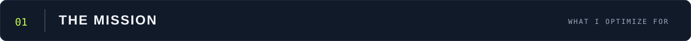
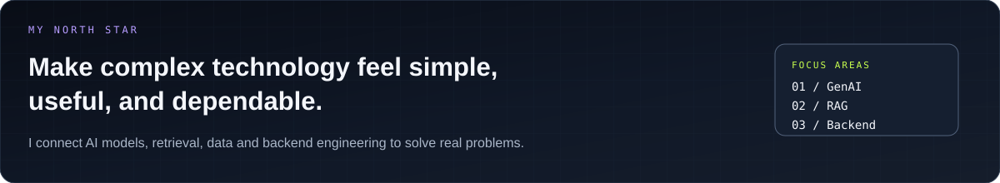
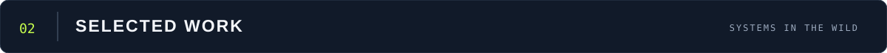
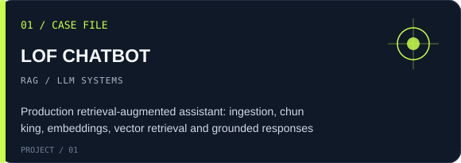
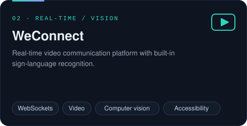
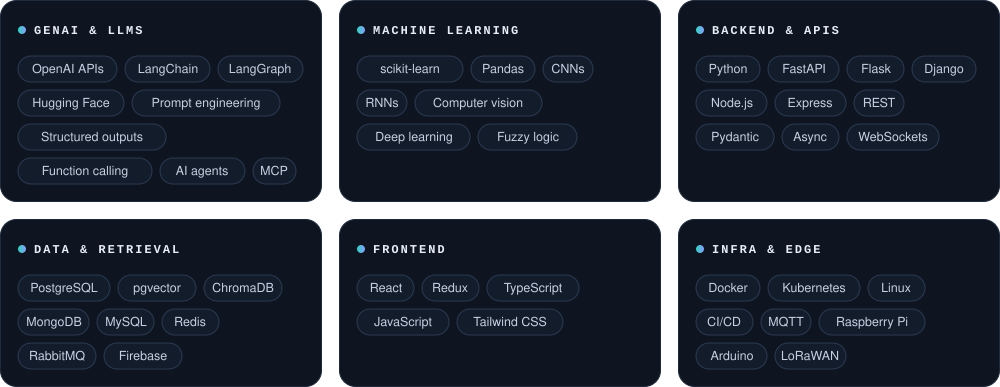
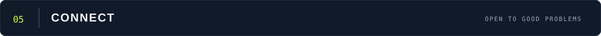

<!-- GOURI PAWAR / AI ENGINEERING FIELD NOTES -->

  

  

 

  

I’m an **AI Engineer** working at the intersection of Generative AI, LLM applications, retrieval systems, machine learning and backend development. I like building the connective tissue that makes AI useful: reliable APIs, thoughtful data pipelines, retrieval workflows and interfaces people can work with.

- **Currently interested in:** production-grade LLM applications, agentic workflows, RAG evaluation and scalable backend systems.
- **Research:** led an international collaboration on AI-based traffic control for unconventional intersections.
- **Education:** B.E. Computer Science Engineering, University of Mumbai — **8.92/10 CGPA**.
- **Approach:** start with the user problem, build deliberately, measure what matters, improve continuously.

 

  
  

  
  

 

  

  
<b>Explore the wider stack</b>

   

  **Languages:** Python, JavaScript, TypeScript, Java, SQL

  **GenAI & LLMs:** OpenAI APIs, Hugging Face, prompt engineering, context engineering, structured outputs, function calling, AI agents, MCP

  **Machine Learning:** scikit-learn, Pandas, CNNs, RNNs, deep learning, computer vision, fuzzy logic, feature engineering

  **Backend & APIs:** FastAPI, Flask, Django, Node.js, Express, REST APIs, microservices, Pydantic, asynchronous programming, WebSockets

  **Frontend:** React, Redux, HTML, CSS, Tailwind CSS

  **Data & Messaging:** PostgreSQL, pgvector, MySQL, MongoDB, Redis, ChromaDB, RabbitMQ, Firebase

  **Tools & Platforms:** Git, GitHub, Docker, Kubernetes, Linux, CI/CD, cloud deployment, MQTT, Raspberry Pi, Arduino, LoRaWAN

 

  
  

 

  
  
  
  

  

  

