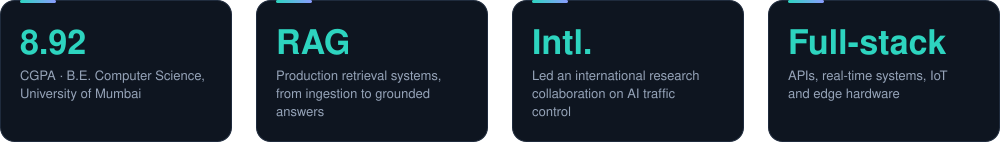

<!-- GOURI PAWAR · profile README · SVG assets are generated by src/build.py -->

  

  

 

I’m an **AI Engineer** working at the intersection of Generative AI, LLM applications, retrieval systems, machine learning and backend development. I like building the connective tissue that makes AI useful: reliable APIs, thoughtful data pipelines, retrieval workflows and interfaces people can work with.

- **Currently interested in:** production-grade LLM applications, agentic workflows, RAG evaluation and scalable backend systems.
- **Research:** led an international collaboration on AI-based traffic control for unconventional intersections.
- **Education:** B.E. Computer Science Engineering, University of Mumbai — **8.92/10 CGPA**.

 

  
  

  
  

 

  

 

  

 

  
  

 

  
  
  
  

  

