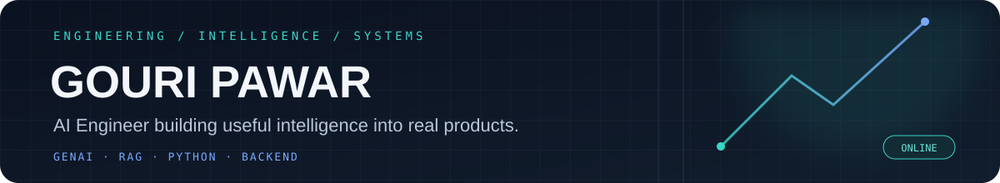
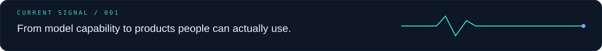
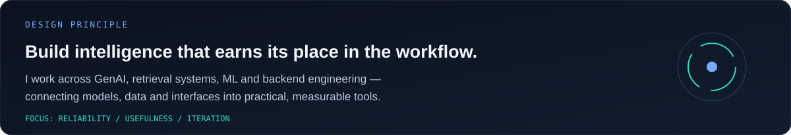
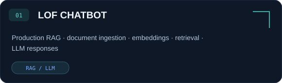
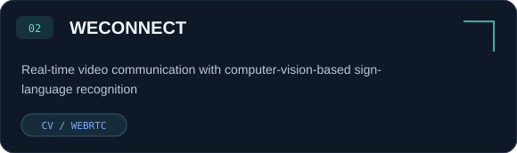
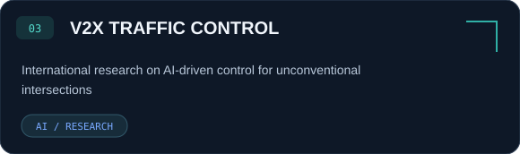
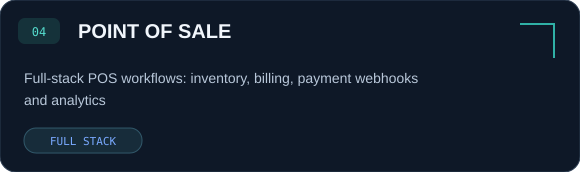
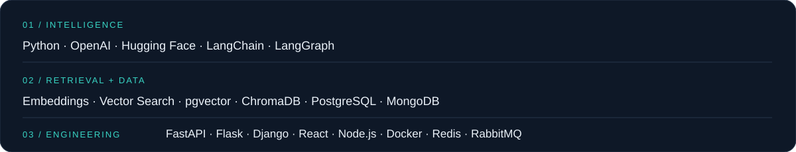

<!-- GOURI PAWAR // AI systems, retrieval, and backend engineering -->

  

  

 

  

I’m an **AI Engineer** working across Generative AI, LLM applications, retrieval systems, machine learning and backend development. I enjoy connecting models, data and software into practical systems — from RAG-powered assistants to real-time applications.

- **Core interests:** GenAI, RAG, LLM applications, AI agents and backend systems.
- **Engineering approach:** understand the problem, build the smallest useful version, measure it, then improve.
- **Research:** led an international collaboration on AI-based traffic control for unconventional intersections.
- **Education:** B.E. Computer Science Engineering, University of Mumbai — **8.92/10 CGPA**.

 

  
  

  
  

 

  

  
<b>More of the stack</b>

   

  **Languages:** Python, JavaScript, TypeScript, Java, SQL

  **GenAI & LLMs:** OpenAI APIs, Hugging Face, prompt engineering, context engineering, structured outputs, function calling, AI agents, MCP

  **Machine Learning:** scikit-learn, Pandas, CNNs, RNNs, deep learning, computer vision, fuzzy logic, feature engineering

  **Backend & APIs:** FastAPI, Flask, Django, Node.js, Express, REST APIs, microservices, Pydantic, async programming, WebSockets

  **Frontend:** React, Redux, HTML, CSS, Tailwind CSS

  **Databases & Messaging:** PostgreSQL, pgvector, MySQL, MongoDB, Redis, ChromaDB, RabbitMQ, Firebase

  **Tools & Platforms:** Git, GitHub, Docker, Kubernetes, Linux, CI/CD, cloud deployment, MQTT, Raspberry Pi, Arduino, LoRaWAN

 

  
  

 

  
  
  
  

  

  

