<!-- GOURI PAWAR · profile README · SVG assets are generated by src/build.py -->

  

 


  

 


  
  
  

  
  
  

 


  

 


  
  

  
  

 


  

 

  

 

  

 


  <a href="https://linkedin.com/in/gouripawar/"></a>
  
  <a href="https://github.com/GouriVPawar">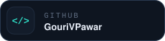</a>

 

  

